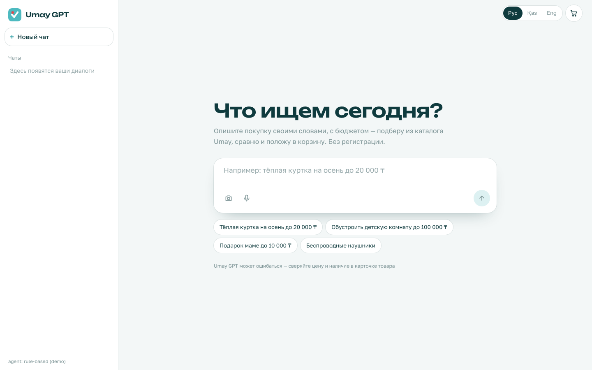

# Umay GPT Next

Прототип обновлённого **Umay GPT** — ИИ-консультанта маркетплейса [Umay](https://umayshop.kz/ai-assistant).
Подбирает **реальные товары Umay** по описанию на русском, казахском и английском, гарантированно соблюдает
бюджет, собирает наборы «под ключ», сравнивает товары и кладёт их в корзину прямо из чата. Работает без регистрации.



## Быстрый старт (Windows / macOS / Linux)

Нужны Python 3.11+ и Node.js 20+.

```bash
# 1. Настройки
cp .env.example .env          # Windows: copy .env.example .env
#    впишите QWEN_API_KEY=... (без ключа заработает демо-агент на правилах)

# 2. Бэкенд — терминал №1
cd backend
pip install -r requirements.txt
uvicorn app.main:app --port 8000

# 3. Фронтенд — терминал №2
cd frontend
npm install
npm run dev                   # открыть http://localhost:3000
```

Проверка: `http://localhost:8000/api/health` должен вернуть `"agent": "qwen:..."` и `"catalog": "live"`.

Или одной командой: `docker compose up --build`.

## Режимы

**LLM** (`LLM_PROVIDER`): `qwen` · `openai` · `anthropic` · `rule` · `auto` (выбирает по найденному ключу).
Qwen подключается через OpenAI-совместимый режим Alibaba Model Studio (DashScope).

| Переменная | Значение |
|---|---|
| `QWEN_API_KEY` | ключ Model Studio / DashScope |
| `LLM_BASE_URL` | международный ключ: `https://dashscope-intl.aliyuncs.com/compatible-mode/v1`; китайский: `https://dashscope.aliyuncs.com/compatible-mode/v1` |
| `UMAY_LLM_MODEL` | по умолчанию `qwen-plus`; точное имя модели смотрите в консоли Model Studio |

Если LLM недоступна или вернула ошибку, сервер **сам переключается на демо-агента** — ответ всё равно приходит.

**Каталог** (`UMAY_CATALOG`):

| Режим | Что это |
|---|---|
| `live` | публичный поиск Umay `POST endpoint.umayshop.kz/product/public/web/product/search/v2` (без авторизации). Цена фильтруется на стороне Umay (`maxPrice`), результат переранжируется локально. При сбое сети — запасной срез |
| `snapshot` | срез реального каталога: 107 товаров по сценариям демо, `backend/data/umay_snapshot.tsv`, работает офлайн |
| `demo` | синтетический каталог для тестов |

## Что улучшено относительно текущего Umay GPT

| Проблема сейчас | Решение в прототипе |
|---|---|
| Без входа чат не работает, введённый запрос стирается окном логина | Гостевой режим: сессия и корзина гостя, вход нужен только для заказа |
| Бюджет не соблюдается (куртка «до 20 000 ₸» → пуховик за 24 092 ₸), хотя API каталога умеет `maxPrice` | Бюджет парсится кодом и ставится **потолком цены** в поиске (`enforce_budget`), даже если LLM его не передала |
| Нерелевантная выдача (брюки среди курток) | Буст за совпадение в названии, категории вместо служебных тегов |
| Обрыв WebSocket: пропадает история, «Думаю…» висит | Каждый ответ — отдельный HTTP-поток (SSE); история на клиенте и сервере |
| Первый ответ 20–25 с | Шаг агента виден сразу, карточки приходят раньше текста |
| В казахском ответе названия товаров по-русски, хотя `subjectKZ` есть в данных | Название берётся на языке пользователя (ru/kk/en) |
| Иероглифы в машинном переводе («свитер из羊毛») | Очистка названий `clean_title` |
| Нет подборки «под бюджет» | Инструмент `build_bundle`: набор, шкала бюджета, остаток |
| Горизонтальный скролл на ~800 px, статичные карточки на главной | Адаптивная вёрстка от 360 px, кликабельные стартовые запросы |

## Возможности

- **Поиск** по свободному описанию и бюджету («до 20к», «20 000 теңгеге дейін», «under 30k»).
- **Набор под бюджет**: «обустроить детскую до 30 000 ₸» → несколько разных товаров с остатком бюджета.
- **Сравнение** «сравни первые два» → таблица с подсветкой лучшего.
- **Корзина из чата** — кнопкой или фразой «добавь первый в корзину»; рассрочка 0-0-24 видна везде.
- **Фото товаров и ссылки** на карточки umayshop.kz (в режимах `live`/`snapshot`).
- **Голос** (Web Speech API) и **поиск по фото** (демо — по доминирующему цвету).
- **Три языка** интерфейса и ответов, автоопределение языка запроса.

## Стек

| Слой | Прототип | Продакшен (предложение) |
|---|---|---|
| Фронтенд | Next.js 14 (App Router), React 18, TypeScript, Tailwind CSS | + TanStack Query, next-intl, Sentry, PostHog |
| Шрифты | Unbounded + Golos Text, self-hosted (@fontsource) | то же |
| Транспорт чата | SSE поверх `fetch` | + `Last-Event-ID` для докачки |
| API | FastAPI, Pydantic v2, Uvicorn | + Gunicorn, OpenTelemetry |
| Агент | tool use; Qwen / OpenAI / Claude; резервный демо-агент | роутинг моделей по сложности запроса, офлайн-оценка качества |
| Каталог | публичный API Umay + локальное переранжирование | OpenSearch (BM25) + векторный индекс (Qdrant / pgvector), RRF |
| Фото, голос | цвет фото (Pillow), Web Speech API | CLIP/SigLIP-эмбеддинги, ASR с казахским |
| Данные | память процесса | Redis (сессии, корзина гостя), PostgreSQL (история, заказы) |
| Инфраструктура | Docker Compose, pytest | Kubernetes, CDN, CI |

## Архитектура

```
Браузер (Next.js)
   │  POST /api/chat  ──►  SSE: session · status · artifact · text · suggestions · done
   ▼
Next.js rewrites /api/* ──► FastAPI
                               ├─ Agent: OpenAICompatAgent (Qwen) | LLMAgent (Claude) | RuleAgent
                               │     ├─ enforce_budget — бюджет из запроса как потолок цены
                               │     └─ tools.py ──► catalog.py ──► API Umay / срез / демо
                               │                └──► store.py   (сессии, корзина)
                               └─ /api/cart, /api/search/image, /api/health, /inspector (dev)
```

| Событие SSE | Назначение |
|---|---|
| `session` | id сессии (гость) и активный агент |
| `status` | шаг агента: «Ищу товары…», «Собираю подборку…» |
| `artifact` | `PRODUCT_LIST`, `BUNDLE`, `COMPARISON`, `CART` |
| `text` | дельта текста ответа |
| `suggestions` | следующие шаги-подсказки |
| `done` | конец ответа |

## API

| Метод | Путь | Описание |
|---|---|---|
| GET | `/api/health` | статус, агент, каталог |
| POST | `/api/chat` | `{message, session_id?}` → SSE-поток |
| GET | `/api/sessions/{id}` | история и корзина |
| GET | `/api/cart?session_id=` | корзина |
| POST | `/api/cart` | `{session_id, product_id, qty}` |
| DELETE | `/api/cart/{product_id}?session_id=` | убрать товар |
| GET | `/api/products/{id}?lang=` | карточка |
| POST | `/api/search/image` | multipart `file` → товары похожего цвета |
| GET | `/inspector` | dev-страница: сырой поток событий (`UMAY_DEV=1`) |

## Тесты

```bash
cd backend && pytest -q
```

9 тестов, без сети и ключей: парсинг бюджета и языка; потолок бюджета для аргументов LLM; бюджет в поиске;
набор в рамках бюджета (в том числе из перечня позиций); цепочка «поиск → сравни → в корзину»; казахский и английский;
**Qwen-совместимый tool-loop на мок-сервере** (модель «забывает» бюджет — код всё равно его соблюдает).
`TEST_CATALOG=snapshot pytest -q` прогоняет те же тесты на срезе реального каталога.

## Структура

```
umay-gpt-next/
├─ backend/
│  ├─ app/
│  │  ├─ main.py        # FastAPI: эндпоинты, SSE, rate-limit, фолбэк агента
│  │  ├─ agent.py       # OpenAICompatAgent (Qwen), LLMAgent (Claude), RuleAgent; enforce_budget
│  │  ├─ tools.py       # схемы инструментов, реализация, артефакты для UI
│  │  ├─ catalog.py     # Catalog / LiveCatalog (API Umay), срез, ранжирование, наборы
│  │  ├─ store.py       # сессии гостя, история, корзина
│  │  └─ static/inspector.html
│  ├─ data/             # umay_snapshot.tsv (реальные товары), products.json (демо)
│  └─ tests/
├─ frontend/            # app/, components/, lib/
├─ docs/screenshots/
└─ docker-compose.yml
```

## Если что-то не работает

| Симптом | Причина и решение |
|---|---|
| `/api/health` показывает `agent: rule-based` | ключ не найден: проверьте `.env` в корне репозитория и `QWEN_API_KEY` |
| В чате «Переключаюсь на резервный режим…» | LLM вернула ошибку: обычно регион ключа не совпадает с `LLM_BASE_URL` или неверное `UMAY_LLM_MODEL`; текст ошибки — в логе бэкенда |
| Нет фото у товаров | режим `demo` или нет доступа к S3 Umay; используйте `UMAY_CATALOG=live` |
| `catalog: snapshot` вместо `live` | проверьте `UMAY_CATALOG=live` в `.env` |

## Ограничения прототипа

- Хранилище в памяти: при перезапуске бэкенда сессии сбрасываются.
- Поиск по фото в демо — по цвету, а не по визуальному сходству.
- Оформление заказа не реализовано: карточки ведут на страницы товаров umayshop.kz.
- Срок доставки — оценка по источнику (склад Umay ~3 дня, 1688/Taobao ~12 дней).
